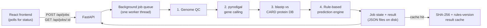

# Genome Firewall

**Antibiotic resistance from a bacterial genome, on day zero.**

## The problem

Culture-based antibiotic susceptibility testing (AST) takes 2–3 days. Until results come back, doctors treat
seriously ill patients with broad-spectrum antibiotics by informed guesswork — and guesswork both under-treats
resistant infections and drives more resistance. Antimicrobial resistance (AMR) is already estimated to
contribute to millions of deaths a year worldwide, and the gap is worst where lab turnaround is slowest: district
and secondary hospitals without same-day molecular diagnostics.

## The solution

Genome Firewall takes an assembled bacterial genome — already produced by increasingly accessible
sequencing — and turns it into an antibiotic-by-antibiotic prediction in minutes, not days. Every call is backed
by gene-level evidence (which gene, where, at what identity and coverage), not a black box. The system is
deliberately conservative: it never says "safe" or "susceptible," only **LIKELY TO FAIL**, **UNCERTAIN**, or
**NO KNOWN RESISTANCE FOUND**, and a poor-quality genome assembly downgrades confidence instead of hiding it.
This is decision support to narrow first-line choices while lab AST is pending — not a replacement for it.

## Key features

- **Antibiogram grid** — all 16 antibiotics across 6 drug classes, colour-coded by status, with a plain-language reason for every call.
- **Evidence drawer** — per-antibiotic gene evidence: identity %, coverage %, match tier, contig and coordinates.
- **Contig map** — an SVG map of the genome's contigs with resistance-gene hit markers in place.
- **Genome QC panel** — contig count, N50, GC%, N-content and a good/fair/poor quality grade.
- **Remaining options** — antibiotics with no known resistance, ranked narrowest-spectrum-first; urinary-only
  drugs (Nitrofurantoin, Fosfomycin) are tagged and never ranked first; if every remaining option is
  urinary-only, the UI says so explicitly instead of looking like a safe systemic choice.
- **Printable report** — a clean, ink-friendly one-to-two-page report for the chart, with the disclaimer in bold.
- **Recent analyses** — the last few runs, so a repeat check doesn't start from zero.

## How it works

Four pipeline stages, run as a background job per analysis:

1. **Genome QC** — parse the FASTA, validate it's DNA (not a protein file or garbage), and grade the assembly
   (contig count, N50, GC%, N-content).
2. **Gene calling** — `pyrodigal` (meta mode) predicts protein-coding genes directly from the contigs.
3. **Resistance gene search** — `blastp` searches the predicted proteins against a local BLAST database built
   from CARD's protein homolog model.
4. **Prediction engine** — our own rule-based logic (not CARD's) turns raw BLAST hits into a three-state call per
   antibiotic (see "Prediction engine design" below).



## Tech stack

| Layer | Technology |
| --- | --- |
| Frontend | React 19, Vite 7, Tailwind CSS v4 |
| Backend | Python 3, FastAPI, Uvicorn |
| Bioinformatics | pyrodigal 3.7.1, NCBI BLAST+ 2.17.0 (blastp/makeblastdb), Biopython 1.88, CARD (Comprehensive Antibiotic Resistance Database) |
| Testing | pytest — 59 backend tests across QC, gene/BLAST parsing, rules, prediction, and full API integration |
| Tooling | `scripts/run_demo.sh` / `scripts/stop_demo.sh`, Git |

## Prediction engine design

The engineered core is the part that stops this from being "a BLAST wrapper":

- **Acquired vs. intrinsic genes.** Every BLAST hit is classified `acquired`, `intrinsic`, or `unclassified`.
  Intrinsic/chromosomal/efflux genes (which even a fully susceptible reference genome carries dozens of) are
  shown as informational only and never drive a failure call — only a real acquired resistance gene can.
- **Mechanism-priority headline.** The one-line headline is chosen by resistance mechanism (carbapenemase > ESBL
  > plasmid AmpC > narrow beta-lactamase > colistin/other), not by which gene happened to be called first in the
  genome — so a plasmid AmpC can never accidentally outrank a true ESBL in the summary.
- **Three-state calls, always.** `LIKELY TO FAIL` / `UNCERTAIN` / `NO KNOWN RESISTANCE FOUND` — never
  "susceptible." Partial/low-confidence BLAST hits and ambiguous SHV/TEM alleles downgrade to `UNCERTAIN` rather
  than guessing either direction.
- **QC-gated confidence.** A poor or fair-quality assembly downgrades every `NO_KNOWN` call to `UNCERTAIN` and
  renames the headline itself ("Incomplete genome — results uncertain") — a bad assembly can never look like a
  clean bill of health.
- **Mutation-driven drugs flagged, not ignored.** Ciprofloxacin, Colistin and Tigecycline resistance is often
  driven by point mutations the pipeline can't see from gene presence alone. Absent an acquired gene (qnr*,
  aac(6')-Ib-cr, mcr-*, tet(X), etc.), these are `UNCERTAIN`, never `NO_KNOWN`.

## Robustness

- **Input validation** with specific, actionable errors for empty files, non-FASTA content, protein FASTA,
  corrupt/oversized gzip, and oversized uploads (25 MB cap) — never a crash or a hang.
- **Persistent jobs.** Job state is written atomically to disk; refreshing mid-analysis resumes polling the same
  job instead of losing it. A server restart marks any job left mid-run as `INTERRUPTED`, with a one-click retry.
- **Simulated failure path.** A BLAST timeout can be triggered deliberately to demonstrate clean failure + retry.
- **Connection-loss handling.** The UI detects repeated failed polls, shows a "Connection lost — retrying" banner,
  and backs off — without losing the last known state.
- **Versioned result cache.** Results are cached by input hash + a rules-version tag, so changing the prediction
  logic never serves a stale result, and the 4 demo samples run in ~2 seconds instead of ~20–40.

## Validation

Besides the 4 samples below, the unmodified pipeline was run once against two public genomes chosen
independently of development (never used to tune the rules):

| Genome | Accessions | Result |
| --- | --- | --- |
| *K. pneumoniae* AATZP (NDM-1 plasmid) | CP014755–CP014758 | Meropenem/Imipenem → LIKELY TO FAIL on NDM-1, 100% identity/coverage |
| *E. coli* with *mcr-1* | CP016404–CP016405 | Colistin → LIKELY TO FAIL on MCR-1.1, 100% identity/coverage; carbapenems correctly NO KNOWN RESISTANCE |

Full context in [DEMO.md](DEMO.md); accessions and licensing are declared in [DECLARED.md](DECLARED.md).

## Quick start

**Prerequisites:** Python 3.11+, Node.js, Homebrew (for BLAST+), internet access for one-time data setup.

```sh
brew install blast
python3 -m venv backend/.venv
backend/.venv/bin/python -m pip install -r backend/requirements.txt
scripts/setup_data.sh          # downloads CARD, builds the BLAST database
scripts/get_samples.sh         # downloads the 3 public demo genomes
scripts/make_demo_inputs.sh    # generates the incomplete-assembly + bad-input fixtures
backend/.venv/bin/python scripts/precompute.py   # pre-caches all 4 sample results
cd frontend && npm install && cd ..
```

Then either run everything with one command:

```sh
scripts/run_demo.sh            # starts backend + frontend, warms caches, health-checks both
# open http://127.0.0.1:5173/#/
scripts/stop_demo.sh           # stops both when done
```

...or run the two halves manually in separate terminals:

```sh
backend/.venv/bin/python -m uvicorn backend.main:app --host 127.0.0.1 --port 8000
```
```sh
npm --prefix frontend run dev -- --host localhost --port 5173 --strictPort
```

## API

| Method | Route | Purpose |
| --- | --- | --- |
| `GET` | `/api/health` | Liveness check |
| `GET` | `/api/samples` | List the built-in demo genomes |
| `POST` | `/api/jobs` | Submit an analysis — multipart `file` or form `sample_id`, optional `simulate` |
| `GET` | `/api/jobs/{job_id}` | Poll job status, pipeline progress and results |
| `POST` | `/api/jobs/{job_id}/retry` | Retry a failed job |
| `GET` | `/api/jobs?limit=10` | List recent analyses, newest first |

Exact request/response JSON shapes are in [PLAN.md](PLAN.md).

## Project structure

```
backend/
  main.py        routes            jobs.py     job queue, cache, retry
  qc.py          FASTA + QC        genes.py    pyrodigal wrapper
  blast.py       blastp wrapper    card.py     CARD index loader
  rules.py       resistance rules  predict.py  the prediction engine
  samples.py     sample registry   tests/      59 pytest tests
frontend/
  src/api.js             API client
  src/App.jsx            app shell, routing
  src/components/        UploadScreen, JobScreen, AntibiogramGrid, EvidenceDrawer,
                         ContigMap, QcPanel, GenesTable, SummaryBar, ErrorPanel, ...
scripts/         setup_data.sh, get_samples.sh, run_demo.sh, stop_demo.sh, precompute.py
demo_inputs/     committed bad-input fixtures (protein FASTA, empty file, gzip, ...)
```

## Limitations

Gene presence/absence only — no point mutation, promoter, or expression analysis. Not CARD RGI, and not a
clinical AST replacement. The CARD-drug-class-to-antibiotic mapping and rule table are our own curation and may
miss rare acquired mechanisms (handled conservatively: an unmatched resistance enzyme becomes `UNCERTAIN`, never
`LIKELY TO FAIL`). Tuned for single-isolate bacterial genomes, not metagenomic/mixed samples.

**Decision support only — confirm with lab AST. Absence of known genes does not prove susceptibility.**

## Credits

CARD (Comprehensive Antibiotic Resistance Database, McMaster University) data is used under its own licence —
non-commercial research use requires permission from McMaster University; see
[CARD terms](https://card.mcmaster.ca/about) and [DECLARED.md](DECLARED.md) for the full note and attribution.
Demo and validation genome accessions are listed in [DEMO.md](DEMO.md) and [DECLARED.md](DECLARED.md), which also
records every third-party library, tool and dataset used.

Built in 8 hours at CHAOS (IEEE RUAS) with AI-assisted development.
